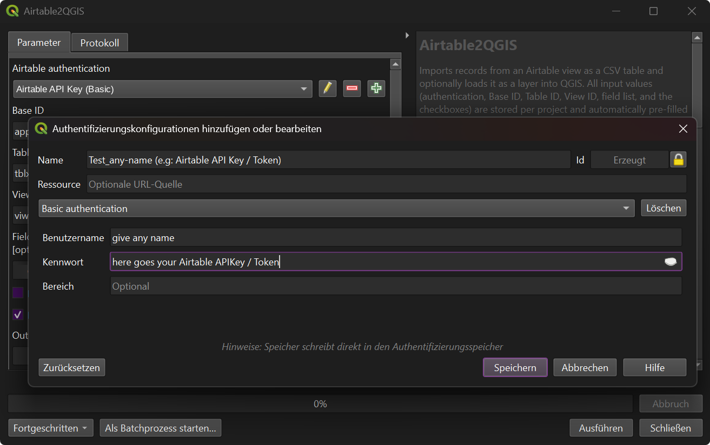
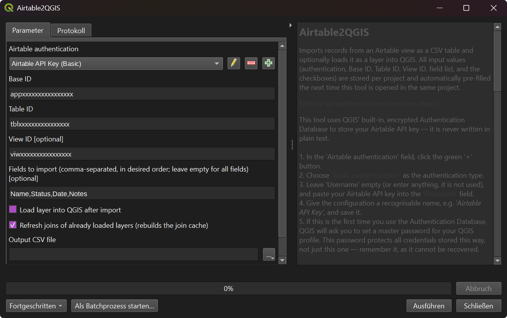
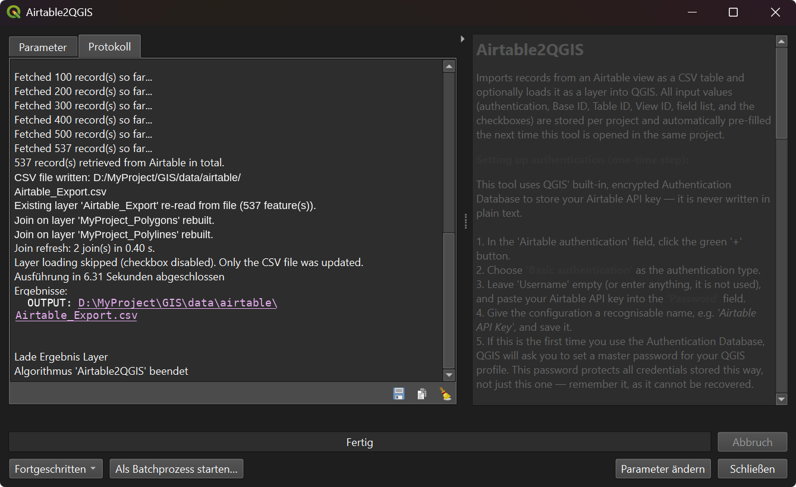

# Airtable2QGIS

A QGIS Processing script that imports records from an Airtable table or view directly into QGIS as a CSV-based layer — with secure, encrypted API key storage, repeatable updates, and **automatic refreshing of layer joins**.

**Current version: v1.3** (`Airtable2QGIS_v1.3`) — see the [release notes](https://github.com/l453rp0mm35/Airtable2QGIS/releases) for what changed.

> **Note on how this was built:** This tool was vibe-coded with the help of Claude Sonnet 5 (Anthropic). The author is not a professional software developer; the code has been tested for the described workflow but has not undergone a formal security or code review. Use at your own discretion, and feel free to open an issue or pull request if you spot a problem.

---

## What it does

- Connects to the [Airtable Web API](https://airtable.com/developers/web/api/introduction) and fetches records from a specified base, table, and (optionally) a filtered view.
- Lets you choose exactly which fields to import, and in which order.
- Writes the result to a CSV file on disk.
- Optionally loads that CSV directly into QGIS as a layer. On repeated runs, it **re-reads the existing layer instead of creating a duplicate**, so that joins you've built against it (e.g. to a geometry layer) are preserved.
- **Refreshes the join cache** of all layers that are joined to the CSV layer, so they show the new Airtable values right away — without removing and re-creating the join by hand (see [Joins and the join cache](#joins-and-the-join-cache)).
- Handles Airtable's array-type fields (multiple select, linked records, lookups, attachments) automatically, converting them into readable, comma-separated text.
- Remembers your last-used settings (Base ID, Table ID, View ID, field list, output path, checkboxes) **per QGIS project**, so repeated syncs require minimal re-entry.

This tool does **not** create geometry. It always produces a plain attribute table. If your Airtable base contains coordinate fields, see [Working with coordinates](#working-with-coordinates) below.

---

## How your API key is handled

Your Airtable API key is **never stored in plain text** and never written into the `.qgz`/`.qgs` project file.

Instead, the script uses QGIS' built-in, encrypted **Authentication Database**:

- The key is entered once into a QGIS "Basic authentication" configuration, which QGIS encrypts and stores in your local profile, protected by a master password you set.
- Only a short, meaningless reference ID to that configuration is saved in the project file — this ID is useless to anyone without access to your local, encrypted authentication database and your master password.
- All other settings (Base ID, Table ID, View ID, field list) are stored in plain text in the project file, as they are not considered sensitive on their own.

See [Setup](#setup) below for how to create the authentication configuration.

---

## Requirements

- QGIS with the Processing Toolbox. Developed and tested with **QGIS 4.2** on Windows. The script only uses standard PyQGIS classes and should also work on QGIS 3.x, but this has not been tested.
- Python `requests` library (included with most QGIS installations; if missing, install via the OSGeo4W shell: `pip install requests`)
- An Airtable account with API access to the base you want to import from

---

## Installation

1. Download `Airtable2QGIS_v1.3.py` from this repository.
2. In QGIS, open **Processing → Toolbox**.
3. At the bottom of the toolbox, click the **Scripts** icon → **Add Script to Toolbox...** (or open the Script Editor and paste the contents, then save it into your `processing/scripts` folder).
4. The tool will appear in the toolbox under **Scripts → Airtable2QGIS_v1.3**.

> **Updating from an earlier version:** delete the old script file (e.g. `Airtable2QGIS_v1.2.py`) and add the new one. Old and new version share the same internal tool ID, so only one of them can be loaded at a time. The inputs are stored per project *and per version*, so you have to enter them once again after an update (Base ID, Table ID, View ID, fields, output path, authentication — about 30 seconds). Your authentication configuration itself is kept.

---

## Setup

### 1. Create an Airtable API key

1. Go to [airtable.com/create/tokens](https://airtable.com/create/tokens).
2. Click **Create new token**.
3. Add the scope **`data.records:read`**.
4. Under **Access**, select the base you want to import from.
5. Create the token and copy it immediately — it is shown only once.

### 2. Store the key in QGIS' Authentication Database

1. Open the **Airtable2QGIS_v1.3** tool from the Processing Toolbox.
2. In the **"Airtable authentication"** field, click the green **+** button.
3. Choose **Basic authentication** as the authentication method.
4. Enter **any username** (e.g. `airtable`) and paste your Airtable API key into the **Password** field.
   > The username is not used by the script, but QGIS keeps the **Save** button disabled as long as the username field is empty.
5. Give the configuration a name, e.g. `Airtable API Key`, and save it.
6. If this is your first time using the Authentication Database, QGIS will ask you to set a **master password** for your QGIS profile. This protects everything stored this way — remember it, as it cannot be recovered.

*Creating the authentication configuration: Basic authentication, any username, and the API key in the password field.*

Once created, this configuration is reusable across projects and other tools, and will be pre-selected automatically the next time you run this tool in the same project.

---

## Finding your Base ID, Table ID, and View ID

| Value | Where to find it |
|---|---|
| **Base ID** | Open your base in the browser. The URL looks like `airtable.com/appXXXXXXXXXXXXXX/...` — the part starting with `app` is the Base ID. |
| **Table ID** | Open the relevant table. The URL extends to `.../tblXXXXXXXXXXXXXX/...` — the part starting with `tbl` is the Table ID. |
| **View ID** *(optional)* | Open the relevant view. The URL extends further to `.../viwXXXXXXXXXXXXXX?...` — the part starting with `viw` is the View ID (ignore any `?...` suffix after it). If left empty, all records of the table are imported. |

---

## Usage

### Parameters

*The dialog. Base ID, Table ID and View ID are masked here.*

| Parameter | Required | Description |
|---|---|---|
| Airtable authentication | Yes | The saved authentication configuration containing your API key (see [Setup](#setup)). |
| Base ID | Yes | See table above. |
| Table ID | Yes | See table above. |
| View ID | No | See table above. Restricts the import to records visible in this view. |
| Fields | No | Comma-separated list of field names, exactly as spelled in Airtable, in the desired column order (e.g. `Name, Status, Date`). Leave empty to import all fields, in the order returned by the API. |
| Output CSV file | Yes | Where the resulting CSV file is written. |
| Load layer into QGIS after import | Yes | Adds the CSV as a layer to the project. Only needed on the first import; see workflow below. |
| Refresh joins of already loaded layers | Yes | Rebuilds the join cache of layers joined to the CSV layer. Enabled by default; see [Joins and the join cache](#joins-and-the-join-cache). |

### Workflow

**First import:**
1. Fill in authentication, Base ID, Table ID, and (optionally) View ID / Fields.
2. Choose a file path for the CSV output.
3. Enable **"Load layer into QGIS after import."**
4. Run the tool. A new layer is added to your project.
5. Set up any joins (e.g. to a geometry layer) against this new layer as usual.

**Subsequent imports (updates):**
1. Run the tool again with the same output path.
2. **Leave "Load layer into QGIS after import" disabled.**
3. Keep **"Refresh joins of already loaded layers"** enabled if the CSV layer is used in joins.
4. The CSV file is overwritten in place, the existing layer re-reads it, and all joins are rebuilt. No manual reload or `F5` is needed.

> Re-enabling "Load layer" on a re-run is safe (it detects the existing layer by file path instead of duplicating it), but leaving it off avoids unnecessary processing if you already have the layer loaded.

*The log of an update run: records fetched, existing layer re-read, joins rebuilt (with the time this took).*

---

## Joins and the join cache

If you join an attribute table to a geometry layer, QGIS offers the option **"Cache join layer in virtual memory"** (*"Verknüpfung im Speicher cachen"* in the German interface). With this option, QGIS copies the values of the joined table once and serves all further lookups from that copy. This is much faster; in the author's project (537 joined rows), switching the option off made QGIS freeze when opening the attribute table of the joined layer.

The catch: that copy is only rebuilt when it is marked as *dirty*. Looking at the QGIS source (`qgsvectorlayerjoinbuffer.cpp`), the cache is only marked dirty when the join layer emits its `layerModified` signal, i.e. when it is edited inside QGIS. If the CSV file is overwritten on disk, none of this happens:

- the CSV layer itself shows the new values (after a reload),
- but the joined layers keep showing the **old** values from the cache,
- `F5` and *Reload* do not help; until now the only remedies were to restart QGIS or to remove and re-create the join by hand.

To fix this, Airtable2QGIS does the following after each import, if **"Refresh joins of already loaded layers"** is enabled:

1. It makes the CSV layer re-read the file, so that the new values are really loaded.
2. It marks the join caches as dirty by emitting the `layerModified` signal of the CSV layer.
3. It removes every join that uses the CSV layer and re-adds it from a **fresh** join object with the same settings (join field, target field, prefix, cache option, field subset, …). A fresh object matters because a copy of the old join object could carry its old, "clean" cache along.

The cache option stays enabled, and you do not have to touch your joins. In a test with 537 records and two joined layers, the rebuild took 0.4 seconds. The time is written to the log; if it becomes too long for your data, or if you do not use joins, disable the checkbox.

Things to keep in mind:

- The option only has an effect if the CSV layer is **already loaded** in the project. It does nothing when the layer is added in the same run.
- Only joins whose join source is the CSV layer written by this run are rebuilt.
- The rebuilt join copies the settings listed above. If you notice any join setting that was not carried over, please open an issue.

---

## Working with coordinates

This tool always imports data as a plain attribute table, without geometry. If your Airtable base contains coordinate fields (e.g. `X`/`Y`, `Longitude`/`Latitude`), you can generate point geometry from the imported table using QGIS' native **"Create points layer from table"** algorithm:

1. Run Airtable2QGIS first to produce the attribute table / CSV layer.
2. Open **Processing Toolbox → Vector creation → Create points layer from table**.
3. Select the layer produced by Airtable2QGIS, specify your X and Y field names and the correct EPSG code.

---

## Known limitations

- Airtable's REST API is limited to **5 requests per second per base**, regardless of your Airtable plan. Very large tables may take a while to import due to pagination. If the limit is hit, the tool waits 30 seconds and retries (up to five times in a row, and the wait can be cancelled).
- Attachment fields are reduced to their file URL(s); the files themselves are not downloaded.
- Multi-select, linked record, and lookup fields (which Airtable returns as arrays) are automatically joined into a single, comma-separated text value.
- Geometry import (points from coordinate fields, or WKT/GeoJSON geometry stored in Airtable) is not built in — see [Working with coordinates](#working-with-coordinates) for a native QGIS workaround for point data.
- The script was developed and tested on Windows. Path handling for Linux and macOS is implemented but has not been tested there.

---

## License

MIT - License

## Author

Th. Leutgeb — Stadtarchäologie Wien
